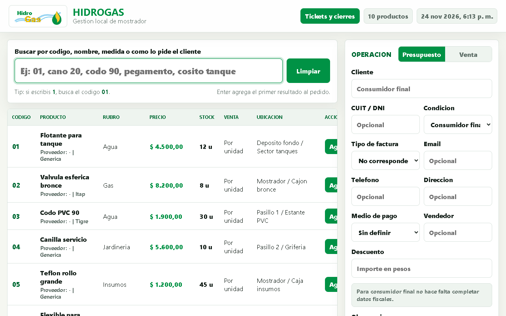

# Hidrogas Gestión

Sistema de mostrador para un comercio de sanitarios y gas: búsqueda de productos, presupuestos, ventas con descuento de stock, cierres de caja y actualización masiva de precios desde la lista del proveedor. Reemplaza presupuestos hechos a mano y una lista de precios en papel.



> El repositorio incluye solo productos de ejemplo; la lista de precios real del comercio no se publica.

## Problema que resuelve

- Los clientes piden productos con nombres poco claros ("el cosito del tanque"), y encontrar el producto correcto lleva tiempo.
- Los presupuestos a mano generan errores de precio, suma y cantidad, y no queda historial.
- La lista del proveedor cambia de precios todos los meses y actualizarla a mano es inviable (más de 1.300 productos).

## Funcionalidades

- **Búsqueda tolerante**: ignora mayúsculas, acentos, plurales y orden de las palabras; reconoce sinónimos del rubro (`caño` / `tubo`, `llave` / `válvula`) y prioriza coincidencias exactas de código interno o de proveedor.
- **Presupuestos y ventas**: armado desde el catálogo, cálculo de totales, descuentos, datos fiscales del cliente; un presupuesto se puede convertir en venta o anular.
- **Stock**: descuento automático al vender y alerta de stock bajo.
- **Tickets y cierres de caja** con historial.
- **Actualización de precios** desde el Excel del proveedor: vista previa de cambios, productos nuevos y faltantes antes de aplicar.
- **Copias de seguridad** de los datos.

## Stack

- **Python 3 solo con la biblioteca estándar**: servidor HTTP propio (`http.server`), API JSON y lectura de archivos `.xlsx` con `zipfile` + `xml.etree`, sin dependencias externas.
- Persistencia en archivos CSV y JSON.
- Frontend en JavaScript, HTML y CSS.

## Arquitectura

```
web_app.py            servidor HTTP y API (/api/products, /api/budgets, /api/checkout, /api/closures, ...)
app.py                lógica de productos, búsqueda, presupuestos y stock (también usable por terminal)
tools/
  import_tigre.py     importa la lista del proveedor desde Excel
  update_prices.py    compara y aplica actualizaciones de precios
web/                  interfaz de mostrador y de movimientos
data/productos.csv    catálogo (datos de ejemplo)
```

## Cómo correrlo

```bash
python web_app.py
```

Abrir `http://127.0.0.1:4180`. No requiere instalar dependencias.

## Notas de diseño

El relevamiento con el comercio, los problemas detectados y las decisiones de cada versión están en [docs/NOTAS_DE_DISENO.md](docs/NOTAS_DE_DISENO.md).
